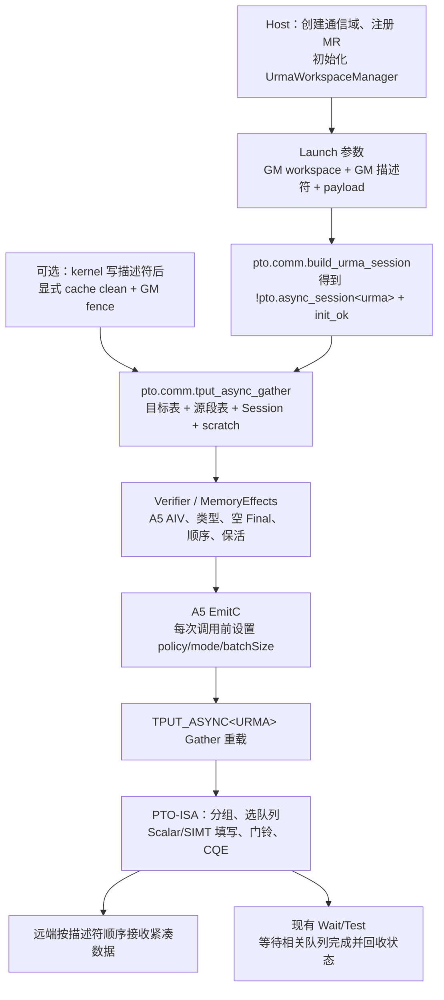

# A5 URMA Gather 高层 IR 与 EmitC 实现设计

- 状态：待评审，尚未实现
- 目标仓库：`cann/pto-as`
- 上游接口：[cann/pto-isa!2058](https://gitcode.com/cann/pto-isa/pull/2058)，合入提交 `9085fb4c7913cf5a8de424f275971a60c40a2bc5`
- PTOAS 设计基线：`gitcode/master` 的 `8717f33fb`

> 本文中的 PTO IR 新类型、新 op、新属性和示例语法均为**拟议接口**，不代表当前
> PTOAS 已经支持。本文只做 PTOAS 接入设计，不重复设计 PTO-ISA 的 SQE 分组、队列选择、
> SIMT 填写、门铃或 CQE 回收算法。

## 1. 背景与问题定义

MoE dispatch/combine 等场景经常需要把本地 GM 中不连续的数据段写到远端连续区间。
若本地逻辑数据是 `A、B、C`，物理布局却为：

```text
本地 GM:  [A][空洞][B][空洞][C]
远端期望: [A][B][C]
```

现有连续 `TPUT_ASYNC` 只能表达一段本地连续区间。调用方只能逐段发送，或先打包到本地
临时缓冲再发送。前者增加描述符、提交和完成开销，后者增加一次本地拷贝及临时内存。

PTO-ISA!2058 已提供 URMA Gather 重载：调用方传入一张目标描述符表和一张源段表，
一次调用可将有序源段拼接到一个或多个远端目标。PTOAS 当前高层异步通信 IR 和 EmitC
仅生成 SDMA 调用，无法表达这条路径。

本特性因此不是把现有 SDMA 调用换一个函数名，而是新增一条完整的高层通信路径：

- 新的 URMA Session 构建方式；
- 可静态区分引擎的 Session 类型；
- Gather 描述符、多目标、多 rank 的 IR 表达；
- CQE 完成策略与门铃提交模式；
- 有状态 Session 的顺序和副作用建模；
- UB scratch 的绑定与保活；
- A5 EmitC 代码生成、诊断、Python IR 绑定和真机验收。

## 2. 上游契约与 PTOAS 边界

### 2.1 已合并的 C++ 接口

上游描述符布局为：

```cpp
struct GatherSegment {
    __gm__ const uint8_t *addr;  // 本地 GM 段起始地址
    uint32_t length;             // 字节数
};

struct GatherDestination {
    __gm__ uint8_t *addr;        // 远端连续目标区间起始地址
    uint32_t segCount;           // 本目标消费的源段数量
    uint32_t peer;               // 目标 rank
};
```

PTOAS 需要生成的是 `TPUT_ASYNC<URMA>` 的 Gather 重载，而不是早期草案中的
`TPUT_ASYNC_GATHER`：

```cpp
auto event = pto::comm::TPUT_ASYNC<pto::comm::DmaEngine::URMA>(
    destinations, destinationCount,
    sourceSegments, sourceSegmentCount,
    session);
```

对应的 URMA Session 构建接口为：

```cpp
// Scalar 路径。
pto::comm::BuildAsyncSession<pto::comm::DmaEngine::URMA>(
    workspace, session);

// 绑定 UB scratch，允许上游选择 SIMT 填写路径。
pto::comm::BuildAsyncSession<pto::comm::DmaEngine::URMA>(
    workspace, scratchTile, session);
```

这与现有 SDMA builder 的参数数量、顺序和配置类型均不同，必须新增独立 lowering，
不能只修改现有 pattern 中的模板实参。

### 2.2 描述符到数据的映射

目标表按下标顺序连续消费源段表。每个目标内部也按源段下标顺序拼接：

```text
sourceSegments = [A, B, C]
destinations   = [{addr: R1, segCount: 2, peer: 1},
                  {addr: R2, segCount: 1, peer: 2}]

rank 1 的 R1: [A][B]
rank 2 的 R2: [C]
```

必须满足：

```text
sum(destinations[i].segCount) == sourceSegmentCount
```

PTOAS 不在设备端重新实现该映射，也不把描述符拆成张量。首版只负责验证 GM 指针和计数
类型、保留描述符读取语义，并生成上述上游调用。描述符内容、MR 范围、peer 范围和段长等
运行时约束仍由上游检查。

### 2.3 完成策略与提交模式是两个正交维度

上游 `session.cfg.urma.cqePolicy` 控制完成通知，`session.submitMode` 和
`session.batchSize` 控制暂存及门铃。PTO IR 必须分别表达，不能把 `DEFER` 等同于
`NoCqe`。

| PTO 属性 | 上游字段/枚举 | 语义 |
|---|---|---|
| `one_cqe` | `UrmaCqePolicy::OneCqe` | 默认值；Event 跟踪本次调用的完成目标，等待时机见第 5.5 节 |
| `no_cqe` | `UrmaCqePolicy::NoCqe` | 含负载调用不请求完成通知；其 Event 不可 `Wait`/`Test`，必须由后续 `Final` 覆盖 |
| `final` | `UrmaCqePolicy::Final` | Event 跟踪本次调用及此前尚未确认的 `NoCqe` 前缀 |
| `immediate` | `AsyncSubmitMode::IMMEDIATE` | 默认值；本次填写后立即发布 |
| `defer` | `AsyncSubmitMode::DEFER` | 暂存；各队列分别累计，达到 `session.batchSize` 的队列按上游规则发布 |
| `defer_and_submit` | `AsyncSubmitMode::DEFER_AND_SUBMIT` | 发布当前及此前暂存的操作 |

一个 Gather 可以涉及多个目标和多条硬件队列。上游返回的一个 Event 负责等齐相关队列；
PTOAS 不自行拆成多个 Event。

`batchSize` 是**逐队列**阈值，不是跨调用的全局操作计数。例如阈值是 2 时，两次调用若
分别落入不同队列，两个队列都只累计 1 次，均不会因阈值自动发布。若调用方此时要发布
全部暂存操作，可以使用 `DEFER_AND_SUBMIT`。

### 2.4 平台边界：首版仅支持 A5，不支持 A6

上游头文件为 A5/A6 都启用了 URMA，但这不构成 PTOAS 的 A6 支持。当前 PTOAS 的
`PTOArch` 只有 A3/A5，命令行也没有 A6 target。本设计明确：

- **只交付 A5 + AIV + EmitC。**
- **不支持 A6**，不新增 A6 target，不把新 op 的 verifier 写成“A5/A6 均可”。
- 不支持 A2/A3、AIC、VPTO 或 CPU simulation。
- 禁止在 `pto.simt_entry`/`pto.section.simt` 等 PTO SIMT 执行域中直接调用两个新 op；
  上游内部使用 `__simt_vf__` 填写不受此限制。
- 不因为上游存在 `PTO_URMA_SUPPORTED` 就宣称 PTOAS 已支持所有定义该宏的平台。

A5 内部还需区分具体 NPU 架构：`PTO_NPU_ARCH_A5` 包含 3101 和 3510，但只有
3510 定义 `PTO_URMA_SUPPORTED`。PTOAS 的 `PTOArch::A5` 无法区分二者，因此：

1. IR verifier 做 A5/AIV 的粗粒度检查；
2. 设备编译必须以 `PTO_URMA_SUPPORTED`/`__NPU_ARCH__ == 3510` 做最终能力收口；
3. 3101 上应产生明确编译错误，不能静默删除 Gather，也不能退回 SDMA。

## 3. 目标与非目标

### 3.1 目标

1. 用两个新 op 暴露 URMA Session 构建和 Gather 提交。
2. 用 `!pto.async_event<urma>` 标记 Gather Event，复用现有 `pto.comm.wait_async_event` 和
   `pto.comm.test_async_event`。
3. 支持单目标、多目标、多 rank、Scalar/SIMT 上游路径和批提交。
4. 支持 `NoCqe` 前缀加空负载 `Final` 的规范收尾形式。
5. 在 IR 层阻断跨引擎 Session 误用及同一 Session 上的非法重排。
6. 保证 UB scratch 在实际最后一次使用前不会被内存规划复用。
7. 提供可自动运行的编译期测试，以及由 **PTOAS 生成 kernel** 驱动的 A5 多 rank
   真机测试。

### 3.2 非目标

- A6 支持及 A6 验收。
- VPTO  lowering；新 op 在 VPTO 中应显式报错。
- PTODSL 高层 API；Python 范围仅限 MLIR op/type/attribute 绑定。
- 修改 PTO-ISA 的 Gather 分组、SIMT 阈值、门铃或完成回收算法。
- 连续 tensor 版 URMA `TPUT_ASYNC`/`TGET_ASYNC` 的高层接入。
- 自动构建 Host 通信域、注册 MR 或隐藏 Host workspace 初始化。
- 首版支持任意跨函数/复杂 region 的 Session-scratch 来源证明；无法唯一证明绑定时拒绝。
- 首版提供 descriptor 构造 DSL、自动 cache 维护或自动跨 rank 同步。

## 4. 总体流程



## 5. PTO IR 接口设计

### 5.1 Session 和 Event 类型增加可选引擎参数

当前 `AsyncSessionType` 是无参数 opaque 类型，无法阻止把 URMA Session 传给现有 SDMA
`TPutAsyncOp`。本设计将其扩展为：

```text
!pto.async_session          // 既有无参数形式，保留兼容
!pto.async_session<urma>    // 新增，URMA 高层 Session
!pto.async_event            // 既有无参数形式，保留兼容
!pto.async_event<urma>      // 新增，URMA Gather Event
```

类型参数复用已有 `PTO_DmaEngineEnum`。首版公开的带参数形式为 `<urma>`。
`build_urma_session` 产生 URMA Session，`tput_async_gather` 产生 URMA Event。Event 类型
标记引擎，具体由哪个 Session 提交仍由第 5.5 节的配对规则检查。

规则如下：

| 操作 | 接受的 Session |
|---|---|
| 既有 `comm.build_async_session` | 继续返回无参数 `!pto.async_session`，行为不变 |
| 新 `comm.build_urma_session` | 返回 `!pto.async_session<urma>` |
| 新 `comm.tput_async_gather` | 只接受 `!pto.async_session<urma>` |
| 既有连续 `comm.tput_async`/`comm.tget_async` | 保持既有无参数路径；显式拒绝 `urma` Session |
| `comm.wait_async_event`/`comm.test_async_event` | 接受无参数 Event/Session 对，以及匹配的 URMA Event/Session 对，见第 5.5 节 |

不能直接复用已有的 `!pto.dma_session<engine>`：该类型服务于微指令层的
`session_init`/`sdma_gm_gm` 和另一套 ABI，当前也没有对应的 EmitC TypeConverter。

无参数旧 IR、既有 C API 和 Python 的 `AsyncSessionType.get(ctx)`、`AsyncEventType.get(ctx)`
保持兼容。URMA 类型使用 Python 的 `AsyncSessionType.get_urma(ctx)`、`AsyncEventType.get_urma(ctx)`
或 C API 的 `mlirPTOAsyncSessionTypeGetUrma`、`mlirPTOAsyncEventTypeGetUrma`。
EmitC 分别映射到 C++ `pto::comm::AsyncSession` 和
`pto::comm::AsyncEvent`，引擎参数用于高层 IR 约束。

### 5.2 新增枚举属性

新增与上游数值一致的枚举，避免无意义的映射转换：

```text
PTO_UrmaCqePolicyEnum:
  no_cqe  = 0
  one_cqe = 1       // 默认
  final   = 2

PTO_AsyncSubmitModeEnum:
  immediate        = 0  // 默认
  defer            = 1
  defer_and_submit = 2
```

对应属性建议为 `#pto.urma_cqe_policy<...>` 和
`#pto.async_submit_mode<...>`。Python 绑定必须覆盖显式零值，防止把 `no_cqe = 0` 或
`immediate = 0` 误当成“未提供”。

### 5.3 `pto.comm.build_urma_session`

拟议语义：

```text
%session, %init_ok = pto.comm.build_urma_session
    workspace(%workspace : !pto.ptr<i8, gm>) [scratch(%scratch : <tile type>)]
    -> !pto.async_session<urma>, i1
```

| 输入/结果 | 类型与含义 |
|---|---|
| `workspace` | `!pto.ptr<i8, gm>`；由 Host `UrmaWorkspaceManager` 初始化 |
| `scratch` | 可选 VEC `tile_buf`；提供时用于上游 SIMT 控制数据 |
| `session` | 不绑定单一 rank 的 URMA Session；peer 来自目标描述符 |
| `init_ok` | 上游 builder 的布尔返回值，不代表任何传输已完成 |

scratch 有两种明确模式：

- 不提供：使用上游 Scalar 能力；
- 提供：静态大小至少为 `sizeof(comm::urma::UrmaGatherSimtScratch)`，当前上游为
  1184 字节，避免“传了过小的 scratch 却静默退回 Scalar”。

即使提供足够 scratch，上游仍可按 SQE 数量阈值选择 Scalar；这不属于编译错误。
需要强制路径的测试使用上游宏，见第 10.5 节。

### 5.4 `pto.comm.tput_async_gather`

拟议语义：

```text
%event, %post_ok = pto.comm.tput_async_gather
    [destinations(%dsts, %dstCount : !pto.ptr<i8, gm>, ui32)
     segments(%segs, %segCount : !pto.ptr<i8, gm>, ui32)]
    session(%session : !pto.async_session<urma>) [scratch(%scratch : <tile type>)]
    [{cqe_policy = ..., submit_mode = ..., batch_size = ...}]
    -> !pto.async_event<urma>, i1
```

| 输入/结果 | 类型与含义 |
|---|---|
| `dsts` | `!pto.ptr<i8, gm>`，指向连续的 `GatherDestination[]` 存储 |
| `dstCount` | `ui32`，目标描述符数量 |
| `segs` | `!pto.ptr<i8, gm>`，指向连续的 `GatherSegment[]` 存储 |
| `segCount` | `ui32`，源段描述符数量 |
| `session` | `!pto.async_session<urma>` |
| `scratch` | 绑定 scratch 时必须提供，且与 builder 是同一个 SSA buffer |
| `cqe_policy` | 默认 `one_cqe` |
| `submit_mode` | 默认 `immediate` |
| `batch_size` | 默认 `UINT32_MAX`；非 Immediate 时不得为 0 |
| `event` | `!pto.async_event<urma>`；完成目标取决于 CQE 策略，等待时机还取决于队列是否发布 |
| `post_ok` | `!event.postFailed`；只表示提交是否失败，不表示数据已完成 |

描述符首版使用 byte pointer，而不是 `!pto.struct`：当前 PTO StructType 不允许 GM
指针字段，不能为这一个特性放宽通用 StructType。EmitC 将其转换为上游要求的
`const GatherDestination*`/`const GatherSegment*`。

#### 有负载形式

四个 payload 参数必须同时出现。若计数是编译期常量，则必须大于 0；动态计数由 EmitC
在写入任何 Session 配置前检查，两个计数都必须大于 0。任一计数为 0 时返回 failed Event
和 `post_ok=false`，不得调用上游、发布暂存操作或修改 Session。

不能把动态 `(0, 0)` 交给上游：上游可能将其视为空调用并返回空 Event，甚至按提交模式
发布此前暂存的操作；等待这个空 Event 成功并不证明那些操作完成。一次调用可包含多个
peer，不受连续 tensor batch 的单 peer 限制。

#### 空负载 `Final` 形式

四个 payload 参数同时省略，lowering 生成
`TPUT_ASYNC<URMA>(nullptr, 0, nullptr, 0, session)`。首版只接受规范组合：

```text
cqe_policy  = final
submit_mode = defer_and_submit
batch_size != 0
```

该限制是 PTOAS 的 canonical form。没有打开的 `NoCqe` 前缀时，调用可以成功但返回空
Event，此时 `post_ok = true`，现有 `Wait`/`Test` 对空 Event 返回 true。
`DEFER_AND_SUBMIT` 仍可发布此前暂存的 `OneCqe` 操作。调用方须保留这些操作各自的
Event，并在发布后用它们确认完成。不得用 `event.valid()` 是否非空来生成 `post_ok`。

### 5.5 Event 使用规则

| 提交结果 | `post_ok` | Event 等待规则 |
|---|---:|---|
| `OneCqe` 或 `Final` 有实际完成目标 | true | 所有目标队列的对应请求发布后才可阻塞 `Wait`，发布前 `Test` 可能返回 false |
| 含负载 `NoCqe` 已受理 | true | 不可 `Wait`/`Test`；等待后续 `Final` |
| 空 `Final` 且没有打开的 `NoCqe` 前缀 | true | 空 Event，`Wait`/`Test` 返回 true。此前发布的 `OneCqe` 仍使用其原 Event |
| 参数检查、初始化或资源预留失败 | false | 不得把 false 解释为“尚未完成” |

一次 `DEFER` 可只发布已达到阈值的部分队列。若 Event 还有未发布的目标，调用方先用
后续提交发布它们，再执行阻塞 `Wait`。完成查询和等待不推进暂存队列的发布范围。

`Test` 返回 true 表示 Event 的目标已完成。对于使用完成槽的多队列 Gather Event，仍需一次成功
的阻塞 `Wait` 让上游退休完成槽，避免长期 `Test` 后耗尽槽位。**每个占用完成槽的 Event
都必须各自成功 Wait**；等待后一个 Event 不会退休前一个 Event 自己占用的槽。

上游按 `session.engine` 分发完成查询。同为 URMA 的两个 Session 也可能属于不同
workspace，必须使用提交该 Gather Event 的 Session。首版 Wait/Test verifier 按类型处理：

1. URMA Event 和 URMA Session 必须成对出现，混搭无参数类型在编译期报错。
2. URMA Event 必须直接来自同一函数的 Gather，且 Wait/Test 的 Session 与提交 operand
   是同一个 SSA 值。经 block argument、helper function、复杂 region 等来源无法证明
   配对时给出诊断。含负载 `NoCqe` 的 Event 即使配对正确也不能等待，由后续 `Final` 覆盖。
3. 无参数 Event/Session 对沿用既有 verifier 行为。SDMA 和 Prefetch Event 可以经 CFG
   block argument 或 helper 转发，调用方仍按现有契约使用对应的 Session。

## 6. 正确性设计

### 6.1 Session 必须建模为 Read + Write

上游 Gather 读取 `cfg.urma.cqePolicy`、`submitMode`、`batchSize`，并推进
`rt.urma.nextWqeSeq`、批状态和完成回收状态；三个配置字段则由本文的 PTOAS lowering
在每次调用前写入。若 IR 只声明 `Read`，不同策略的
两个 Gather 在 MLIR 看来可以自由重排，而生成 C++ 的最后写入者会决定实际策略。

例如 `NoCqe` 载荷与 `Final` 被交换后，程序仍可能编译，但完成语义已经错误。因此新
Gather 的 Session operand 必须同时具有 `Read` 和 `Write`，不能照抄当前
`addAsyncTransferEffects`。

首版 effects 设计为：

| Op/资源 | Read | Write | 原因 |
|---|---:|---:|---|
| Gather `dsts`/`segs` | 是 | 否 | 调用期间读取描述符 |
| Gather `session` | 是 | **是** | 写配置并推进运行时状态 |
| Gather `scratch` | 是 | 是 | SIMT 控制数据会被改写 |
| Gather `event`/`post_ok` 结果 | 否 | 是 | 新结果 |
| Gather 默认内存资源 | 是 | 是 | 描述符内隐藏了本地源和远端目标，保守防止 payload 重排 |
| Build `workspace` | 是 | 否 | 读取 Host 初始化的上下文 |
| Build `scratch` | 是 | 否 | 绑定地址和大小 |
| Build `session`/`init_ok` 结果 | 否 | 是 | 初始化新结果 |
| Wait/Test `event` | 是 | 否 | 读取句柄和完成目标 |
| Wait/Test `session` | 是 | **是** | 轮询 CQ、写回运行时状态；Wait 还退休完成槽 |
| Wait/Test 默认内存资源 | 是 | 是 | 保守建立隐藏 payload、workspace/CQ 与完成点之间的读写边界 |

Gather 的描述符 operand 不能表达描述符内部指向的 payload，Wait/Test 的 Event/Session
operand 也不能单独表达这些内存。因此首版给 Gather 和 Wait/Test 都添加 DefaultResource
的保守 Read+Write：既防止提交前的 payload 写被移到提交后，也防止 Wait 后的源覆盖或目标
读取被移到完成前。后续若引入专用 completion resource，可在证明等价顺序保证后收窄。

同一 PR 的实现还应修正既有连续 `TPutAsyncOp`/`TGetAsyncOp` 及 Wait/Test 的 Session
和默认资源 effects：上游 SDMA/URMA 的 `rt` 都是 mutable，既有 `Read` 同样偏松，隐藏
payload 也需要完成边界。该修正需要配套
A3 SDMA 回归测试，不能用“新 op 没复用旧 helper”来回避。

### 6.2 每次调用都完整设置策略，包括默认值

策略通过 IR attribute 表达，但上游接口实际从同一个 C++ Session 读取。lowering 必须在
**每次** Gather 前按固定顺序生成：

```cpp
session.cfg.urma.cqePolicy = ...;
session.submitMode = ...;
session.batchSize = ...;
auto event = TPUT_ASYNC<URMA>(..., session);
```

即使 IR 省略属性，也必须生成默认赋值 `OneCqe + IMMEDIATE + UINT32_MAX`。
否则前一个 `NoCqe + DEFER` 会污染后一个采用默认属性的 Gather。

不得复制 Session 后修改副本，因为副本会切断 `rt.urma` 的跨调用状态。IR 的 Write effect
保证这些写和调用相对于同一 Session 的其他有状态操作保持顺序。

上游 `cfg` 注释目前写着“Written once at build time”，而同 PR 的公开示例又在调用间修改
`cqePolicy`。实现前需要上游 owner 明确这一契约或提供 per-call policy 参数。若上游改为
per-call 参数，PTO IR 属性可保持不变，仅调整 lowering；在契约未澄清前，不应把该歧义
隐藏成已确认事实。

### 6.3 scratch 保活与绑定一致性

只在 builder 上引用 scratch 不足以保活。现有内存规划会把 builder 视为最后一个 use，
之后允许将同一块 UB 分给其他分配，而上游 Session 仍保存其地址。

本设计让绑定 scratch 的每个 Gather 都显式携带同一个 scratch operand。这样普通 use-def
和内存规划即可延长 live range，无须引入全局 `keepAlive` 机制。

仅有 operand 还不够：保活一块不同的 scratch 并不能保护 Session 实际绑定的地址。
首版采用以下可验证约束：

1. 有 scratch 的 builder 与其 Gather 位于同一函数；
2. Session 必须能唯一追溯至该 builder；
3. Gather 的 scratch 必须与 builder 的 scratch 是同一个 SSA buffer；
4. 无法证明绑定的 block argument、跨函数传参或复杂 region 来源暂时拒绝，而不是猜测；
5. 无 scratch builder 产生的 Session 不得给 Gather 传 scratch，反之亦然。

scratch 只需覆盖到最后一次非空 Gather 的调用读取/填写阶段；空 `Final` 也保留该 operand
以统一检查。UB scratch 不必仅因 UB 本身而延长到 Event Wait，但 Session、workspace、
源和目标 payload 仍须遵守各自的完成生命周期。

### 6.4 描述符、payload 与 cache 生命周期

| 对象 | 最小生命周期/发布要求 |
|---|---|
| 目标与源段描述符数组 | 至少到本次 Gather 调用读取结束；调用返回后可复用，若上游契约收紧则以上游为准 |
| 本地源段字节 | 到相关可等待 Event 成功完成；`NoCqe` 段由后续 `Final` 覆盖 |
| 远端目标区间 | 到相关 Event 成功完成，调用方不得提前读取或复用 |
| Session 与 URMA workspace | 覆盖相关 Event 的 Wait/Test 和完成回收 |
| UB scratch | 至少到最后一次绑定它的 Gather；不得中途被其他 UB 分配覆盖 |

若 kernel 在 GM 中写入描述符，提交同一 Session 的执行流必须先用现有 PTO IR 显式执行
cache clean 和 GM fence，使描述符在 URMA 读取前可见。例如使用现有
`pto.cmo.cacheinvalid`（其当前 lowering 为 `dcci` cache clean）和
`pto.fence.barrier_all #pto.fence_scope<gm>`（生成 `dsb(DSB_DDR)` 及必要 pipe drain）。

PTOAS 首版不自动推断描述符写入范围，也不自动插入跨 rank payload 同步。

## 7. EmitC lowering 设计

### 7.1 URMA builder pattern

新增独立 `PTOBuildUrmaSessionToEmitC`，不复用 SDMA 的六参 pattern：

1. 创建普通可写的 `pto::comm::AsyncSession` 局部变量；
2. 将 workspace 转为 GM byte pointer；
3. 有 scratch 时生成 `BuildAsyncSession<URMA>(workspace, scratch, session)`，
   无 scratch 时生成 `BuildAsyncSession<URMA>(workspace, session)`；
4. 将 builder 返回值同时映射为 `init_ok`，不能像现有 SDMA pattern 一样丢弃；
5. 不生成 `SdmaBaseConfig`、`syncId`、`channelGroupIdx` 或 `destRankId`。

### 7.2 Gather pattern 与初始化保护

不能直接在上游检查 `session.engine` 之前写 `session.cfg.urma.cqePolicy`。若 builder
失败或 Session 引擎错误，这种写入会访问错误的 union 状态。生成代码必须先检查运行时
状态，再修改配置。逻辑等价于：

```cpp
pto::comm::AsyncEvent event =
    pto::comm::AsyncEvent::Failed(pto::comm::DmaEngine::URMA);
if (session.valid && session.engine == pto::comm::DmaEngine::URMA) {
    // 有负载形式：任何配置写入和上游调用之前拒绝动态零计数。
    if (dstCount > 0u && segCount > 0u) {
        session.cfg.urma.cqePolicy = pto::comm::urma::UrmaCqePolicy::OneCqe;
        session.submitMode = pto::comm::AsyncSubmitMode::IMMEDIATE;
        session.batchSize = UINT32_MAX;
        event = pto::comm::TPUT_ASYNC<pto::comm::DmaEngine::URMA>(
            reinterpret_cast<__gm__ const pto::comm::GatherDestination *>(dsts),
            dstCount,
            reinterpret_cast<__gm__ const pto::comm::GatherSegment *>(segs),
            segCount,
            session);
    }
}
bool post_ok = !event.postFailed;
```

实际实现可使用 EmitC 表达式/控制流或一个明确的内部 helper，但必须保持以下可测试性质：

- 写配置前检查 `session.valid` 和 `session.engine`；
- 有负载形式在写配置前检查 `dstCount > 0 && segCount > 0`，零计数不调用上游；
- 使用同一个 Session 对象，不复制；
- 每次完整设置三个字段；
- 指针转换为上游 const descriptor pointer；
- `post_ok` 来自 `postFailed`，不是 `valid()`；
- 失败路径返回 URMA failed Event 和 false。

调用方仍应根据 `init_ok` 组织正常控制流；上述检查是防止错误 IR/异常路径写坏 Session
的最后保护，不替代 `init_ok` 结果。

### 7.3 空 `Final` lowering

空形式省略描述符 operand，由 pattern 自行生成空指针和零计数：

```cpp
session.cfg.urma.cqePolicy = pto::comm::urma::UrmaCqePolicy::Final;
session.submitMode = pto::comm::AsyncSubmitMode::DEFER_AND_SUBMIT;
session.batchSize = 4u;  // 示例值
auto finalEvent = pto::comm::TPUT_ASYNC<pto::comm::DmaEngine::URMA>(
    nullptr, 0u, nullptr, 0u, session);
bool finalPostOk = !finalEvent.postFailed;
```

该片段同样位于第 7.2 节的 Session 有效性保护内。

### 7.4 Wait/Test 与 C++ 重写

继续生成现有 `PTOAS__ASYNC_EVENT_WAIT`/`PTOAS__ASYNC_EVENT_TEST` 哨兵，再由
`ptoas_cpp_rewrite.cpp` 改为 `event.Wait(session)`/`event.Test(session)`。
Gather 是自由函数，不需要新增成员调用改写规则。

`PTOToEmitCTypeConverter` 将无参数和 URMA 形式分别映射到现有 C++ `AsyncSession` 和
`AsyncEvent` 类型。URMA 配对在 IR verifier 完成，C++ 调用继续使用提交时的 Session 对象。

## 8. 使用示例

以下 PTO IR 是便于讨论的目标语法，省略了冗长的 `tile_buf` 布局字段；实现时以最终 ODS
assembly format 为准。

### 8.1 双目标、双 rank

目标：把 `A+B` 写入 rank 1 的 `R1`，把 `C` 写入 rank 2 的 `R2`。

```text
%session, %init_ok = pto.comm.build_urma_session
    workspace(%workspace) scratch(%scratch)
    -> !pto.async_session<urma>, i1

// dsts[0] = {R1, 2, 1}; dsts[1] = {R2, 1, 2}
// segs[0] = {A, lenA}; segs[1] = {B, lenB}; segs[2] = {C, lenC}
// 若由 kernel 写表，这里先显式 cache clean + GM fence。

%event, %post_ok = pto.comm.tput_async_gather
    destinations(%dsts, %two) segments(%segs, %three)
    session(%session) scratch(%scratch)
    {cqe_policy = #pto.urma_cqe_policy<one_cqe>,
     submit_mode = #pto.async_submit_mode<immediate>,
     batch_size = 4294967295 : ui32}
    -> !pto.async_event<urma>, i1

// 正常控制流要求 init_ok && post_ok，然后：
%done = pto.comm.wait_async_event(%event, %session)
    -> i1
```

预期远端结果：

```text
rank 1 / R1: [A 的 lenA 字节][B 的 lenB 字节]
rank 2 / R2: [C 的 lenC 字节]
```

`init_ok` 和 `post_ok` 用于检查初始化和提交是否成功。本例直接 `Wait` 确认数据完成，
同时回收多队列完成槽。

### 8.2 `NoCqe` 前缀与空 `Final`

目标：暂存两批有负载写入，只用一个空 `Final` 发布并等待整个前缀。

```text
%e0, %ok0 = pto.comm.tput_async_gather
    destinations(%dsts0, %n0) segments(%segs0, %s0)
    session(%session) scratch(%scratch)
    {cqe_policy = #pto.urma_cqe_policy<no_cqe>,
     submit_mode = #pto.async_submit_mode<defer>,
     batch_size = 4 : ui32}
    -> !pto.async_event<urma>, i1
// %e0 不可 Wait/Test；%ok0 只表示这一调用是否被成功受理。

%e1, %ok1 = pto.comm.tput_async_gather
    destinations(%dsts1, %n1) segments(%segs1, %s1)
    session(%session) scratch(%scratch)
    {cqe_policy = #pto.urma_cqe_policy<no_cqe>,
     submit_mode = #pto.async_submit_mode<defer>,
     batch_size = 4 : ui32}
    -> !pto.async_event<urma>, i1

%ef, %okf = pto.comm.tput_async_gather
    session(%session) scratch(%scratch)
    {cqe_policy = #pto.urma_cqe_policy<final>,
     submit_mode = #pto.async_submit_mode<defer_and_submit>,
     batch_size = 4 : ui32}
    -> !pto.async_event<urma>, i1

%done = pto.comm.wait_async_event(%ef, %session) -> i1
```

`NoCqe -> NoCqe -> Final` 必须保持该程序顺序。成功等待 `%ef` 后，前两批源数据才允许
复用。若只调用 `Test` 并观察到完成，还需一次成功的 `Wait` 回收多队列完成槽。

### 8.3 默认策略只能在 `NoCqe` 前缀收尾后恢复

默认值重置保留独立的 FileCheck：连续两个 Gather 中，第一次显式
`no_cqe + defer`，第二次省略全部策略属性，生成代码必须出现两轮完整赋值，第二轮恢复
`one_cqe + immediate + UINT32_MAX`。该测试只验证代码生成，**不是可执行的真机正例**。

上游在存在 `OpenNoCqePrefix` 时明确拒绝直接切换到 `OneCqe`。真机正例必须写成：

```text
NoCqe + DEFER 有负载调用
  -> 空 Final + DEFER_AND_SUBMIT
  -> 成功 Wait(Final Event)
  -> 新的有负载调用省略属性，恢复 OneCqe + IMMEDIATE + UINT32_MAX
  -> 成功 Wait(默认 Event)
```

上游在 Final 发布、`OpenNoCqePrefix` 关闭后允许默认路径提交。本用例先成功 Wait，
以确认前缀数据完成并回收完成槽。原来的
`NoCqe + DEFER -> OneCqe + IMMEDIATE` 直接转换保留为真机负例，预期 `post_ok=false`，
不得把它写成默认策略恢复成功的示例。

## 9. 代码改动清单

| 位置 | 计划改动 |
|---|---|
| `include/PTO/IR/PTOTypeDefs.td` | 为高层 AsyncSessionType、AsyncEventType 增加可选 engine 参数及兼容 parser/printer |
| `include/PTO/IR/PTOAttrs.td` | 新增 UrmaCqePolicy、AsyncSubmitMode 枚举和属性 |
| `include/PTO/IR/PTOOps.td` | 新增 BuildUrmaSessionOp、TPutAsyncGatherOp；定义可选 payload/scratch、属性、两个结果和 verifier/effects 接口 |
| `lib/PTO/IR/PTOCore/PTOCoreImports.cpp` | 补全新 op/type/attr 的聚合翻译单元引用 |
| `lib/PTO/IR/PTOPipeline/PTOAsyncCommunicationVerification.cpp` | 新 op verifier、payload/空 Final 形式、A5/AIV、scratch 绑定、URMA Wait/Test 配对及连续 SDMA op 的 Session 引擎约束 |
| `lib/PTO/IR/PTOPipeline/PTOSimtVerificationAndAsyncEffects.cpp` | 新 op effects；既有 TPut/TGet 的 Session 改为 Read+Write |
| `lib/PTO/IR/PTOPipeline/PTOCollectivePipelineEffectsAndConvertAssembly.cpp` | Wait/Test Session 改为 Read+Write，并增加隐藏 payload 的默认资源完成边界 |
| `lib/PTO/IR/PTOPipeline/PTOHistogramScaleAndScatter.cpp` 等 | 仅复用 `dispatchVerifierByArch` 范式，不要求修改该文件 |
| `lib/PTO/Transforms/PTOToEmitC/ScalarMisc/AsyncSession.cpp` | 新 builder/Gather pattern、运行时 Session 和动态零计数检查、策略赋值、空 Final、post_ok |
| `lib/PTO/Transforms/PTOToEmitC/PTOToEmitCPass.cpp` | 按需生成 URMA Gather helper 和 A5 3510 设备编译检查 |
| `lib/PTO/Transforms/PTOToEmitC/PTOToEmitCTypeConverter.cpp` | 参数化 Session 和 Event 复用既有 C++ 类型转换 |
| `lib/PTO/Transforms/Passes/PTOValidateVPTOIR.cpp` | 将两个新 op 加入显式拒绝列表，诊断改为 async DMA/EmitC-only |
| `include/pto-c/Dialect/PTOCAPI.h`、`lib/CAPI/Dialect/PTO.cpp` | 参数化 Session 和 Event C API，保留旧入口 |
| `lib/Bindings/Python/PTOModule.cpp`、`python/pto/dialects/pto.py` | 新 type/attr 构造和导出；op class 由 ODS 自动生成 |
| `test/lit/pto/`、`test/lit/vpto/`、`test/python/` | 新增第 10 节编译期和绑定测试 |
| `test/comm/urma_gather/` | 多 rank Host harness，通过 PTOAS 生成端到端用例的 kernel |
| `.github/scripts/update_pto_isa_pin.py` 管理的 pin | 升级到包含 PTO-ISA!2058 的提交，并同步脚本管理的 CI/docker/文档引用 |

新增源文件和脚本必须带 PR386 OAT.3 license 头。Python op 类由
`-gen-python-op-bindings` 生成，但参数化 type、新 enum attr 和辅助构造仍需手工绑定及测试。

## 10. 测试设计

### 10.1 原则与验收矩阵

测试必须同时覆盖“生成了预期文本”和“编译器不会破坏语义”。仅跑 CSE/canonicalize 后
顺序未变不足以证明 effects 正确，因为当前 pipeline 未必触发问题重排；必须直接断言
MemoryEffects，并验证删去 Write 后测试会失败。

| ID | 层级 | 用例 | 通过标准 |
|---|---|---|---|
| IR-01 | parser/round-trip | 无参数和 `<urma>` 形式的 Session 和 Event 类型 | 旧 IR 不变，新类型打印/解析一致 |
| IR-02 | verifier | URMA Gather 使用无参数或 SDMA Session | 明确拒绝跨引擎/无类型 Session |
| IR-03 | verifier | 既有连续 SDMA op 使用 URMA Session | 明确拒绝 |
| IR-04 | verifier | block argument 上的 URMA Session | 引擎类型检查不依赖直接 defining op；scratch 来源不能证明时给出专属错误 |
| IR-05 | verifier | 四个 payload 参数缺任意一个 | 拒绝“半空”形式 |
| IR-06 | verifier | 空形式使用非 Final 或非 DeferAndSubmit | 拒绝并说明 canonical form |
| IR-07 | verifier | 常量 payload 计数为 0、Defer/DeferAndSubmit 的 batch_size 为 0（含空 Final） | 编译期拒绝 |
| IR-08 | verifier | 描述符不是 byte GM pointer、count 不是 ui32 | 明确类型诊断 |
| IR-09 | verifier | scratch 非 VEC、动态形状或小于 1184 字节 | 拒绝；无 scratch 的 Scalar 形式仍接受 |
| IR-10 | verifier | builder 与 Gather scratch 不是同一 SSA buffer | 拒绝，不能仅保活另一块 UB |
| IR-11 | verifier | 含负载 NoCqe Event 直接接 Wait/Test | 编译期拒绝 |
| IR-12 | 架构 | A3、AIC、`pto.simt_entry`/`pto.section.simt` 中直接使用两个新 op | 显式不支持诊断；另覆盖 URMA typed Session 的 Wait/Test 架构负例 |
| IR-13 | VPTO | 两个新 op 进入 VPTO 验证 | 命中显式拒绝列表，不落入其他 lowering |
| IR-14 | 架构 | A6 输入/target | 保持当前不支持；不得为本特性新增 A6 正向用例 |
| IR-15 | verifier | URMA Event 配无参数 Session、旧 Event 配 URMA Session、URMA Event 配另一个 URMA Session | 混搭类型立即拒绝；同引擎时拒绝与提交 operand 不同的 Session |
| IR-16 | verifier | URMA Event 经 block argument、helper function 或复杂 region，无法证明提交配对 | 仅 URMA 路径拒绝来源不明的配对 |
| EF-01 | C++ unit | 直接查询 Gather Session effects | 同一 operand 同时包含 Read 和 Write |
| EF-02 | C++ unit | 查询既有 TPut/TGet、Wait/Test effects | Session 均包含 Read+Write，Wait/Test 另含默认资源 Read+Write，Event 本身保持 Read |
| EF-03 | pass | 两个不同策略 Gather 经 CSE/canonicalize/相关 pipeline | 不被 CSE，程序顺序不变 |
| EF-04 | 变异测试 | 临时移除 Gather Session Write 后运行 EF-01 | 测试必须失败；合入代码不包含该变异 |
| EF-05 | pass | NoCqe 前缀、Wait/Test、Final 的同一 Session 序列 | 不发生跨操作重排 |
| EF-06 | pass | Wait 后覆盖源 payload、读取目标 payload，以及 Test 的完成分支 | 读写不得越过完成查询/等待边界；移除 Wait/Test 默认资源 effects 后测试失败 |
| EC-01 | lit/EmitC | A5 无 scratch builder | 参数顺序为 `(workspace, session)`，返回 init_ok |
| EC-02 | lit/EmitC | A5 有 scratch builder | 参数顺序为 `(workspace, scratch, session)`，无 SDMA config |
| EC-03 | lit/EmitC | 有负载 Gather | 正确的 descriptor 类型转换、ui32 计数、URMA callee |
| EC-04 | lit/EmitC | 空 Final | 生成 `(nullptr, 0, nullptr, 0, session)` 和 Final/DeferAndSubmit |
| EC-05 | lit/EmitC | 连续非默认调用后接默认调用，仅检查代码生成 | 两次都完整设置 policy/mode/batchSize，第二次恢复默认值；不作为真机正例 |
| EC-06 | lit/EmitC | 全部 Gather | 配置写入位于 valid/engine 检查之后，使用同一 Session 变量 |
| EC-07 | lit/EmitC | 提交结果 | `post_ok = !event.postFailed`，不依赖 `event.valid()` |
| EC-08 | lit/EmitC | Wait/Test | 最终 C++ 为同一 Event/Session 的 `.Wait()`/`.Test()` |
| EC-09 | 设备编译 | A5 3101 或无 `PTO_URMA_SUPPORTED` 环境 | 明确编译失败，不生成空操作或 SDMA fallback |
| EC-10 | lit/EmitC | 有负载形式使用动态计数，另检查空 Final | 两个 `>0` 检查位于所有 Session 配置写入前；零计数不调用上游，空 Final 不受该检查阻断 |
| MEM-01 | memory planning | build(scratch) 后分配另一块 UB，再执行 Gather | 两块 live range 重叠但物理地址不重叠，后分配块不能覆盖 scratch |
| MEM-02 | memory planning | 多次 Gather 和空 Final | scratch 至少保活到最后一个绑定它的 Gather |
| MEM-03 | lit | kernel 写描述符后提交 | 示例和测试包含 cache clean + GM fence，EmitC 顺序在 Gather 前 |
| PY-01 | Python binding | 新旧 AsyncSessionType.get、AsyncEventType.get | 旧签名兼容，新 URMA 类型可构造、解析和比较 |
| PY-02 | Python binding | 默认属性和显式 `no_cqe=0`、`immediate=0` | 不把显式零值误判为缺省，round-trip 正确 |
| PY-03 | Python binding | Gather 有/无 payload、有/无 scratch | 自动 op binding 的 optional operand 构造和 round-trip 正确 |
| REG-01 | 既有 lit | A3 SDMA async、Prefetch、微指令 dma_session | 全部通过，无语法或生成代码回归 |
| REG-02 | lit/EmitC | SDMA 和 Prefetch 各自产生无参数 Event，经 CFG block argument 转发，在目标块使用原 Session 执行 Wait/Test | 两条旧路径均通过 verifier 和 EmitC，等待同一传输 |
| NPU-01 | A5 3510 | 无 scratch builder + FORCE_SCALAR；单目标，4KiB/8KiB 不等长源段，段间留空洞 | Scalar 端到端路径确实执行，远端逐字节等于紧凑源段拼接 |
| NPU-02 | A5 3510 | 两个目标属于不同 rank，segCount 为 2+1 | 两个 rank 分别得到 A+B、C；一个 Event 等齐 |
| NPU-03 | A5 3510 | 12 段满组及 13/25 段尾巴 | 分组边界数据正确，无段遗漏或重叠 |
| NPU-04 | A5 3510 | 多轮 NoCqe 负载 + 空 Final + Wait | 所有前缀完成；每轮 Final Event 都成功 Wait，无完成槽泄漏 |
| NPU-05 | A5 3510 | 空 Final 且没有待收尾工作 | post_ok=true，Wait/Test=true，无卡死 |
| NPU-06 | A5 3510 | 多队列、使用 `kUrmaGatherSlotEvent` 的 OneCqe Event 重复 Test 后成功 Wait | 结果正确，完成槽退休并可复用；长期运行不耗尽 |
| NPU-07 | A5 3510 | NoCqe+Defer 后先空 Final 并成功 Wait，再调用默认 OneCqe+Immediate | 默认 Event 可等待且数据正确；OpenNoCqePrefix 已清除，默认值确实重置 |
| NPU-08 | A5 3510 | 源描述符调用后复用、payload 在 Wait 后复用 | 复用时序符合契约，下一轮数据仍正确 |
| NPU-09 | A5 3510 | kernel 写描述符并执行显式 cache/fence | 上游读取到完整新描述符，无旧表数据 |
| NPU-10 | A5 3510，非 debug/关闭断言 | 空指针+非零 count、段长 0、segCount 总和不符、非法 peer | post_ok=false，无部分提交被误认为成功；debug 构建允许先 PTO_ASSERT/trap |
| NPU-11 | A5 3510 | SQ/CQ 压力、队列环绕和多目标多队列 | 回收正确，多轮后仍可提交，无提前复用 |
| NPU-12 | A5 3510 | 每 AIV 独立 Session，多 AIV 并行 | 不共享 Session，结果正确且无状态串扰 |
| NPU-13 | A5 3510，非 debug/关闭断言 | 无效 workspace 使 init_ok=false，错误调用路径仍到达 Gather | 运行时保护不写配置、不调用上游 Gather，post_ok=false 且无 union 误访问 |
| NPU-14 | A5 3510 | OneCqe+Defer，batchSize=2，两次有负载调用固定落入同一队列，不写空 Final | 第二次使该队列达到阈值并自动发布；两个 Event 均按规则成功 Wait，两批数据完成 |
| NPU-15 | A5 3510 | OneCqe+Defer，batchSize=2，两次调用分别落入不同队列，再以一次有负载 OneCqe+DeferAndSubmit 显式发布 | 前两次不因全局调用数达到 2 而自动发布；第三次发布所有暂存队列，所有相关 Event 分别成功 Wait |
| NPU-16 | A5 3510 | 连续产生两个各自占用多队列完成槽的 Event，先成功 Wait 后一个而不 Wait 前一个 | 后一个 Wait 不得退休前一个槽；随后仅对前一个执行首次 Wait，后续轮次使用新 Event，不重复 Wait 已退休 Event，长期运行不耗尽槽位 |
| NPU-17 | A5 3510，非 debug/关闭断言 | 暂存 NoCqe 前缀；用有负载形式传运行时 `(0,0)` + Final+DeferAndSubmit | post_ok=false，队列发布 head 不变；随后用规范空 Final 发布并 Wait。临时移除动态计数 guard 时，同一输入会成功并发布前缀，测试必须失败 |
| NPU-18 | A5 3510，非 debug/关闭断言 | OpenNoCqePrefix 存在时直接调用默认 OneCqe+Immediate | 上游拒绝且 post_ok=false；随后用空 Final+Wait 收尾，验证默认路径成功 |
| NPU-19 | A5 3510 | OneCqe+Defer（batchSize=UINT32_MAX）暂存并保留原 Event，尚无 NoCqe 前缀；提交规范空 Final | 发布前原 Event 的 Test 返回 false；空 Final 发布暂存队列，返回空 Event；以原 Event 的成功 Wait 确认 OneCqe 数据完成 |
| SIMT-01 | A5 3510 | 同一描述符/数据分别跑无 scratch+FORCE_SCALAR 和足量 scratch+FORCE_SIMT | 两次确实走指定路径，远端逐字节一致 |
| SIMT-02 | 构建检查 | FORCE_SIMT 且无 SIMT 可用宏或 scratch 不足 | 测试失败而非静默 Scalar fallback |

所有 NPU/SIMT 用例必须使用 PTOAS 从 PTO IR 生成并编译的 kernel。直接运行 PTO-ISA
手写 kernel 只能作为上游参考，不能替代本特性的端到端验收。

### 10.2 代表性 EmitC 测试形状

新增 A5 正向 lit 测试，不再只有 A3 正向和 A5 VPTO 负向。核心检查示意为：

```text
// RUN: ptoas --pto-arch=a5 %s 2>&1 | FileCheck %s

// CHECK: pto::comm::AsyncSession [[S:[_A-Za-z][_A-Za-z0-9]*]]
// CHECK: BuildAsyncSession<pto::comm::DmaEngine::URMA>({{.*}}, {{.*}}, [[S]])
// CHECK: if ({{.*}}[[S]].valid{{.*}}[[S]].engine{{.*}}URMA
// CHECK: [[S]].cfg.urma.cqePolicy = {{.*}}NoCqe
// CHECK: [[S]].submitMode = {{.*}}DEFER
// CHECK: TPUT_ASYNC<pto::comm::DmaEngine::URMA>({{.*}}[[S]])
// CHECK: [[S]].cfg.urma.cqePolicy = {{.*}}OneCqe
// CHECK: [[S]].submitMode = {{.*}}IMMEDIATE
// CHECK: [[S]].batchSize = UINT32_MAX
// 两次调用之间不得插入另一轮策略写或复制 Session
```

实际测试应按 EmitC 最终格式拆分宽松的表达式检查，不能用一条过度严格的正则绑死
合法格式变化；但两次赋值顺序、同一 Session 和默认重置必须是强断言。

空 Final 另设独立文件，检查四个实参、canonical 属性和 `post_ok`；错误组合放在 verifier
负例中，避免仅靠生成文本证明合法性。

### 10.3 A5 真机 Host harness

现有 remote NPU 脚本会跳过 `async_comm` runtime，并对含 `pto::comm::` 的生成 kernel
按多卡场景跳过运行，因此不能直接在脚本里增加一个目录就宣称完成验收。需要专用 harness：

1. 至少两个 rank，完成通信域初始化和同步；
2. 使用 `ACL_MEM_MALLOC_HUGE_ONLY` 分配对称数据缓冲，注册本地/远端 MR；
3. 用 `UrmaWorkspaceManager` 初始化与 device 相同版本的 workspace；
4. 每个发送 AIV 使用独立 Session；
5. 将 PTOAS 生成的 kernel 编译、下发并运行；
6. Host 在 rank 间 barrier 后校验远端字节、错误状态和重复轮次；
7. 保存 PTO IR、生成 C++、实际 PTO-ISA 头文件版本、编译命令和运行日志。

测试环境要求 CANN Toolkit >= 9.1.0。A5 3101 只作为编译负例，A6 不在本次测试矩阵中。

### 10.4 PTO-ISA 依赖检查

PTOAS 的 GitCode 默认 pin 升级到 `7db8bb0a9e64888ea7c0557f8d0a275440e9f3c8`，
并同步统一 pin 管理脚本覆盖的引用。

仅修改 pin 不足以证明验证环境使用了新接口：vendored PTO-ISA 无 `.git` 时，现有脚本可能
跳过 checkout。测试日志必须额外证明实际头文件包含 `GatherDestination` 和 Gather
`TPUT_ASYNC<URMA>` 重载，Host workspace 初始化与 device 编译使用同一版本。

### 10.5 让 Scalar/SIMT 验收可观测

上游会根据 SQE 阈值、scratch 和 `PTO_URMA_GATHER_SIMT_AVAILABLE` 自动选路；小请求即使
带 scratch 也可能走 Scalar。仅观察结果正确不能证明 SIMT 被执行。

测试构建分别定义：

```text
PTO_URMA_GATHER_FORCE_SCALAR
PTO_URMA_GATHER_FORCE_SIMT
```

强制 SIMT 用例同时满足：

- 编译环境定义 `PTO_URMA_GATHER_SIMT_AVAILABLE`；
- scratch 至少 1184 字节；
- 使用足够多 SQE 的确定性形状，避开自动阈值；
- 强制路径被拒绝时测试失败，不允许回退后仍报告通过。

性能测试可复用同一 harness，分别记录描述符填写、提交和完成回收耗时，并与逐段发送、
本地打包后连续 PUT 对照。首版先建立可复现数据，不预设未经验证的性能提升比例。

## 11. 实施阶段与合并门槛

### 阶段 0：冻结契约

- 确认上游 pin 和 Host/device 版本一致；
- 澄清 `cfg`“build 时写一次”注释与公开 per-call 示例的冲突；
- 评审拟议 IR、空 Final canonical form 和 scratch 来源限制；
- 明确本特性不包含 A6。

### 阶段 1：类型、verifier 与顺序安全

- 完成参数化 Session 和 Event、枚举和两个 op；
- 首先落地 Read+Write effects 及直接 effects 单测；
- 完成 A5/AIV、VPTO、NoCqe Event、scratch 绑定等诊断；
- 跑通 IR、Python 和既有 A3 SDMA 回归。

### 阶段 2：最小 EmitC 链路

- 落地无 scratch Scalar builder 和单目标 `OneCqe + Immediate`；
- 落地初始化保护、post_ok 和既有 Wait/Test；
- 用 A5 lit 和 A5 3510 生成 kernel 验证单目标字节结果。

### 阶段 3：多目标、批提交和保活

- 接入多 rank 目标、scratch operand、空 Final；
- 通过 MEM/NPU 多轮测试后再开放批提交示例；
- 验证默认策略重置及完成槽复用。

### 阶段 4：强制 Scalar/SIMT 对照与发布

- 带合法 scratch 验证强制路径；
- 完成异常、压力、性能和全量回归；
- 文档公开支持矩阵、Host 要求、生命周期和已知限制。

每个阶段都以对应测试通过为进入下一阶段的条件。尤其不能先开放 `NoCqe` 再补顺序或
完成槽测试。

## 12. 方案取舍

| 方案 | 结论 | 原因 |
|---|---|---|
| per-call IR 属性 + Session Read/Write | 首版采用 | 改动集中，匹配当前上游公开用法；必须每次重置默认值 |
| 每次状态变更返回新 SSA Session | 暂不采用 | 只给“改策略”返回新值不够，所有提交/等待都需穿线，还要处理 SSA 分叉 |
| 复用无参数 AsyncSession + defining-op verifier | 拒绝 | block argument 会失去来源，无法稳定阻止引擎混用 |
| 复用微指令 `!pto.dma_session<urma>` | 拒绝 | ABI 和后端不同，且缺少 EmitC 转换 |
| 只在 builder 引用 scratch | 拒绝 | 内存规划会在 Gather 前释放/复用 UB |
| Gather 携带任意 scratch operand | 拒绝 | 必须证明与实际 builder 绑定的是同一块 |
| 用 `event.valid()` 生成 post_ok | 拒绝 | 空 Final 可成功但 handle 为 0；NoCqe 的 valid 也不代表可等待 |
| URMA Event 使用带引擎类型 | 首版采用 | 保留无参数 SDMA/Prefetch Event 的既有验证；URMA 配对需要证明为提交时的 Session |
| 首版自动支持 A6 | 拒绝 | 当前 PTOAS 无 A6 target，未做架构、测试和发布验证 |

## 13. 待确认问题

1. **上游配置契约**：`cfg` 注释与公开示例冲突，需要 owner 明确 per-call 修改是否受支持，
   或提供正式的 per-call policy 参数。
2. **依赖落点**：选择 `9085fb4c...` 本身还是包含后续修复的兼容后代，需由统一 pin 流程
   和真机结果决定。
3. **来源分析扩展**：首版拒绝无法证明 URMA scratch 绑定或 Event-Session 配对的跨函数或
   复杂 region 用法。后续是否引入专门的 Session-scratch、Event-Session token 或数据流分析另行评审。
4. **性能目标**：待统一 harness 建立 Scalar/SIMT、逐段发送和本地打包的基线后再设数值门槛。

这些问题不影响本文明确的设计约束：在它们解决前，不得以省略检查、静默回退或扩大支持
矩阵的方式绕过。

## 14. 最终验收标准

只有同时满足以下条件，才能声明“A5 URMA Gather 的 PTOAS A5/AIV/EmitC 首版完成”：

- 新 IR、类型和属性可 round-trip，旧 SDMA/Prefetch IR 和跨块 Event 传递、既有 Python 用法兼容；
- 引擎混用、URMA Event-Session 错配或来源不明、非法空 Final、NoCqe Event 误用、非 A5/AIV、
  VPTO 和非法 scratch 有明确诊断；
- Gather、既有异步传输和 Wait/Test 的 Session effects 正确，顺序安全测试可因移除 Write
  而失败；
- EmitC 正确处理 builder 参数序、初始化保护、动态零计数拒绝、每次默认重置、空 Final 和
  post_ok；
- scratch 不会被提前复用，且保活对象就是 builder 实际绑定对象；
- A5 3510 上由 PTOAS 生成 kernel 通过单目标、多 rank、Final 后恢复默认策略、逐队列阈值、
  发布后的 Event 等待、多轮 NoCqe/Final、每个完成槽 Event 独立 Wait、动态零计数防护、异常
  和强制 Scalar/SIMT 对照测试；
- A3 SDMA 和现有异步回归通过；
- 文档和发布材料明确写明：**当前不支持 A6，也不支持 VPTO/PTODSL 高层入口。**

## 参考资料

- [PTO-ISA!2058：URMA Gather 合入实现](https://gitcode.com/cann/pto-isa/pull/2058)
- [PTO-ISA TPUT_ASYNC 文档（合入提交）](https://gitcode.com/cann/pto-isa/blob/9085fb4c7913cf5a8de424f275971a60c40a2bc5/docs/isa/comm/TPUT_ASYNC_zh.md)
- [PTO-ISA Gather 公共重载](https://gitcode.com/cann/pto-isa/blob/9085fb4c7913cf5a8de424f275971a60c40a2bc5/include/pto/comm/pto_comm_inst.hpp#L478-L495)
- [PTO-ISA URMA builder](https://gitcode.com/cann/pto-isa/blob/9085fb4c7913cf5a8de424f275971a60c40a2bc5/include/pto/comm/async_common/async_event_impl.hpp#L46-L67)
- [PTOAS 当前异步 Session EmitC lowering](https://gitcode.com/cann/pto-as/blob/8717f33fb/lib/PTO/Transforms/PTOToEmitC/ScalarMisc/AsyncSession.cpp)
- [PTOAS 内存一致性设计](ptoas-memory-consistency-design.md)
