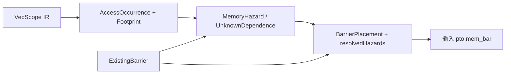

# VecScope MemBar 自动插入设计

## 1. 目标与范围

VecScope 内的 UB（Unified Buffer）向量和标量内存访问可能由不同硬件流水线执行。硬件不会
仅根据 PTO IR 中的 SSA 顺序自动建立所有 UB 别名访问之间的顺序，因此在存在真实内存依赖时，
需要插入 `pto.mem_bar`。

本设计描述 `lib/PTO/Transforms/VecScopeMemBar` 的自动插入流程：

1. 收集 VecScope 的调度结构和内存访问；
2. 计算同一迭代及循环携带的内存 hazard；
3. 为 hazard 选择消费者侧的结构化 anchor；
4. 先保留各 directed barrier 候选，由统一可达性校验消除冗余，再按 barrier family 合并；
5. 将计划写回为 `pto.mem_bar`。

该 pass 分别处理 `pto.vecscope` 和 `pto.strict_vecscope` 内的 UB 访问，不承担 GM 同步。
不同 address space 的访问可直接判定不重叠。Sibling VecScope 之间的同步不在当前 pass
入口的处理范围内；源码中的 `runCrossVecScopeMemBarAnalysis` 不由该入口调用。

## 2. Pass 入口与阶段

`PTOInsertVecScopeMemBarPass` 对每个 VecScope 依次执行：

```text
runVecScopeMemBarAnalysis(scope)
        |
        v
solveVecScopeMemBarPlacement(result)
        |
        v
applyVecScopeMemBarPlan(result, plan)
```

分析阶段不修改 IR。placement 阶段只生成 `VecScopeMemBarPlan`，codegen 阶段才插入操作。
当前 scope 的分析或 placement 失败时，不应用该 scope 的计划；pass 随即失败。
多个 scope 是逐个分析并写回的，因此不提供整个函数的事务式回滚。

`PTOInsertVecScopeMemBarAllPass` 是独立的保守模式。它在每个符合条件的 UB 内存访问前插入
family-wide barrier：向量访问前为 `SV_ALL` + `VV_ALL`，标量访问前为 `VS_ALL`。
标量流水线已经保证标量到标量的顺序，因此不插入 `SS_ALL`。该模式不使用本设计的别名和依赖分析。

## 3. 访问模型

### 3.1 访问单位

每个 `AccessOccurrence` 记录：

- `Load` 或 `Store`；
- `Vector` 或 `Scalar`；
- UB memory footprint；
- 所属循环嵌套、调度路径和词法顺序；
- 对应的 MLIR operation。

当前收集器根据 UB memory effect 和操作类别区分访问单位：`pto.load`、`pto.store`
以及实现 `SimtOpInterface` 的 UB 内存操作归为 Scalar，其余符合 UB 读写判定的操作
归为 Vector。不能仅凭是否实现该接口判定 `pto.load/store` 的单位。实际访问形状由
`buildAccessDescriptor` 识别，不应将 memory effect 的识别范围等同于所有形状都能精确分析。
访问描述符还保存 base、address space、字节偏移、保守字节长度和是否必须按 may-alias 处理。

### 3.2 Footprint 与别名

footprint 将访问归一化为：

```text
(memory root, address space, affine byte offset, optional byte size)
```

别名分析返回三种结果：

- `NoAlias`：可以证明两个访问不重叠；
- `MustOrPartialAlias`：可以证明存在重叠；
- `MayAlias`：无法进一步证明，必须保守保留 hazard。

常量地址使用精确区间重叠。带循环 induction variable 的地址使用 Presburger 关系分析；动态
或不支持的表达式不能直接当作无依赖。需要区分别名结果 `MayAlias` 和依赖结果 `Unknown`：
前者表示可能别名，后者表示关系无法建模。记录的 `UnknownDependence` 会经
`materializeUnknownDependences` 转成保守 hazard，并保留访问方向、family 和 carrying loop，
交给统一 placement。该兜底覆盖已收集的顺序访问及共享 `scf.for` 的循环携带访问，
不意味着已经支持任意 CFG 或 `scf.while` 回边。

## 4. Hazard 分类

Hazard 由 producer 访问类型、consumer 访问类型和访问单位共同决定。分类必须同时保留访问
方向和 vector/scalar family：

| Producer → Consumer | Barrier |
| --- | --- |
| Vector store → vector load | `VST_VLD` |
| Vector store → scalar load | `VST_LD` |
| Scalar store → vector load | `ST_VLD` |
| Scalar store → scalar load | 无需 barrier（标量流水线有序） |
| Vector load → vector store | `VLD_VST` |
| Vector load → scalar store | `VLD_ST` |
| Scalar load → vector store | `LD_VST` |
| Scalar load → scalar store | 无需 barrier（标量流水线有序） |
| Vector store → vector store | `VST_VST` |
| Vector store → scalar store | `VST_ST` |
| Scalar store → vector store | `ST_VST` |
| Scalar store → scalar store | 无需 barrier（标量流水线有序） |

RAR 不修改 UB，因此不生成内存 hazard barrier。标量到标量的 RAW/WAR/WAW 由标量流水线保证顺序，
普通自动插入模式也不生成 `ST_LD`、`LD_ST`、`ST_ST` 或 `SS_ALL`；手写 barrier 保留。

### 4.1 Barrier family 语义

Barrier kind 的 family 是语义的一部分，不能仅依据名称中的 `ALL` 进行跨族合并：

| Family | 方向 | ALL barrier |
| --- | --- | --- |
| VV | vector → vector | `VV_ALL` |
| VS | vector → scalar | `VS_ALL` |
| SV | scalar → vector | `SV_ALL` |
| SS | scalar → scalar | 无需 barrier（标量流水线有序） |

例如，`VV_ALL` 只能覆盖 vector → vector hazard，不能替代 `VST_LD` 或 `VS_ALL`。同一
anchor 同时需要 `VST_VLD` 和 `VST_LD` 时，必须保留两个 directed barrier；不能将它们错误
合并为 `VV_ALL`。

## 5. 依赖分析

### 5.1 同一迭代的顺序访问

对于词法上先出现的访问对，先判断地址是否可能重叠，再判断是否存在顺序关系。确定的
RAW/WAW hazard 直接记录；WAR（load → store）延迟到 SSA 和已知 barrier 图构建完成后处理。

### 5.2 SSA 顺序图

`getLoadedValues` 和 `getStoredValues` 提取内存操作的结果和值。若后续 store 的 payload 依赖
前一 load 的结果，则加入：

```text
load -> store
```

该边表示值流本身已经约束了两次访问的先后。值依赖可以经过纯值操作传播，并限制递归深度，
避免异常 IR 导致无界分析。

### 5.3 Store-to-load 顺序边

已生成或输入中存在的 store-to-load barrier 会把 producer store 与适用单位的后续 load 相连：

```text
store -> barrier -> load
```

只有 barrier family 与 producer/consumer 单位匹配时才加入该边。`VV_ALL` 不会被解释为覆盖
scalar consumer；`VS_ALL`、`SV_ALL` 和 `SS_ALL` 也只覆盖各自 family。
对于输入中已有的 barrier，分析阶段还要求 store、barrier、load 位于同一个 block，
且满足 `store < barrier < load`。条件分支内或可能零次执行的循环内的 barrier，
不能为外部访问建立这条顺序边；尚未证明的跨 region 顺序保守保留。

从 pending WAR load 出发做可达性搜索。如果最终 store 可达，则 load → store 的显式 WAR barrier
是冗余的；否则记录对应单位和方向的 WAR kind。

### 5.4 循环携带依赖

共享循环嵌套的访问对还会构造 inner/outer Presburger 关系：

- 空关系：没有循环携带 hazard；
- 非空关系：记录 `InnerLoopCarried` 或 `OuterLoopCarried` hazard；
- 无法建模：在相关共享循环上记录 `Unknown`，转成对应方向的保守循环携带 hazard。

循环携带 barrier 的 anchor 是 carrying loop 的 terminator，语义是约束下一次迭代的回边。

## 6. Placement

### 6.1 Anchor

同一迭代 hazard 默认放在 consumer 之前。跨嵌套 region 时，沿 producer 和 consumer
的祖先链寻找同 block 中先后排列的节点，anchor 取 consumer 一侧的节点，例如 consumer
所在的 `scf.for`。该规则是结构化的消费者侧 cut，不是一般 CFG 上的最优插入点算法。

循环携带 hazard 放在 carrying loop terminator 前，并标记为 `BeforeLoopTerminator`。

### 6.2 同 anchor 合并

同一个 anchor 的 hazard 先按 directed kind 分别生成 `BarrierPlacement`，并完整保存
`resolvedHazards`。这样冗余校验可以独立删除某一个方向，不会因为过早合并为 `*_ALL`
而掩盖候选的冗余性。统一校验完成后，同一 anchor、同一 family 的幸存 directed kind
才合并为该 family 的 `*_ALL`；不同 family 始终保留独立的 placement。

因此，下列结果是合法的：

```text
pto.mem_bar "VST_VLD"
pto.mem_bar "VST_LD"
```

而将这两个不同 family 的 hazard 单独表示为 `VV_ALL` 是不合法的。

### 6.3 冗余消除

所有 hazard 先正常映射到候选 anchor，不在分析结果中预先跳过 WAW。候选生成后由统一的
`eliminateTransitiveMemBars` 校验器执行删除：它暂时移除一个候选，用幸存的已有/计划 barrier
边和同一迭代 SSA 值边重建顺序图，并重新检查端点可映射到候选所在 block 且对应不同祖先节点的全部同一迭代 hazard
obligation；只有这些 obligation 仍可达时才删除该候选。循环 latch 候选和无法映射到直线 cut 的候选保守保留。

因此冗余证明只依赖最终仍存活的屏障，不再另设 hazard-set 子集、共享 resolver 计数或中间
producer 扫描等独立删除规则。跨 family 的 barrier 不能互相覆盖。已有 `pto.mem_bar` 只有
在 anchor、family、方向匹配时才认为已覆盖；`VV_ALL` 不提供跨 family 的通配覆盖。

## 7. Codegen 不变量

codegen 只消费 placement 结果，不重新做 alias 分析。插入前检查 anchor 仍位于原 VecScope
内。每个 `BarrierPlacement` 生成一个 `pto.mem_bar`，并按 plan 顺序插入。

当插入 family 的 ALL barrier 时，只能删除同一 anchor 前、同一 family 中被它规范化的旧
directed barrier；不能删除其他 family 的 barrier。


## 8. 为什么拆分分析、放置和写回

内存依赖与 barrier 指令不是一一对应：多个访问对可以共享一个 cut，同一个 cut 又可能需要
不同 family 的 barrier。若在扫描每个访问对时立即修改 IR，后续分析看到的词法顺序和已有
barrier 集合就会随扫描过程变化，难以解释哪些约束来自原始 IR、哪些来自本轮生成。

因此分析保留访问对和稳定的 hazard id，placement 再将访问对映射到 cut。每个候选记录
`resolvedHazards`，用于说明它解决的依赖集合。codegen 不再重新推断依赖，只执行计划。
这也使问题定位可以分成三个问题：是否判对别名、是否选对 cut、是否生成正确 family。

主要对象之间的关系如下：



`VecScopeScheduleNode` 和调度路径字段为结构化调度建模提供数据结构。当前 `buildSchedule`
主要创建根 sequence 并收集 `scf.for`；实际 pair 分析依赖访问收集顺序、循环 nest 和 operation
祖先关系。它尚不是完整的 CFG 调度树或路径可达性分析。

## 9. Footprint 的设计细节

### 9.1 为什么统一为字节

IR 中 pointer offset 通常以元素为单位，而不同类型的 load/store 元素宽度不同。别名判断
必须将 offset 和访问长度转换到同一单位。对于连续访问，可写成半开区间：

```text
start = root_base + element_offset * element_bytes
end   = start + accessed_element_count * element_bytes
range = [start, end)
```

例如 f32 的 `ub[152]` 位于相对 root 的第 608 字节；单个 scalar load 长度为 4 字节。
不能将 IR 中的元素 offset 直接与字节长度比较。

两个非空连续区间重叠的条件是：

```text
startP < endC && startC < endP
```

该条件也是 Presburger 地址相交约束的基础。`byteSize` 为空表示无法建立闭合访问范围，
不是长度为零。

### 9.2 Root 决定地址是否可比较

| Root kind | 含义 | 分析用途 |
| --- | --- | --- |
| Absolute | 可解析的绝对 UB 地址 | 不同 SSA pointer 也可以按数值比较 |
| ProvenAllocation | 有明确分配身份 | 不同且可证明独立的分配可排除别名 |
| Symbolic | 相对于某个符号 base | 同 root 的偏移可以比较 |
| Unknown | 无法解析 root | 不能凭 pointer SSA 不同就排除别名 |

同一个地址可以经过 cast、addptr 或循环传递形成多个 SSA value，因此 SSA identity 不是
内存 identity。反过来，共享 root 也不意味着必然重叠，还需比较 offset 与长度。

### 9.3 Mask 和 distribution 必须影响访问长度

Store footprint 应描述实际写入的内存范围，而不是简单使用输入 vreg 的存储宽度。
当前实现会识别部分常量 mask，例如全 false、固定有效 lane 数和常量 `plt`，缩小连续写入
长度。不能解析的 mask 保留完整候选长度，避免凭未知 mask 错误证明 NoAlias。

Pack distribution 根据打包比例计算写入元素数并向上取整；broadcast load 按其实际读取
字节宽度计算，不能把广播后的整个寄存器宽度视为 UB 读取长度。
Gather/scatter 等不能用单个精确连续区间描述的访问使用 `forcesMayAlias` 等标记。
这些标记使分析失去部分精确排除能力。无法建立关系时记录 Unknown 并生成保守 hazard；
最终是否需要独立 barrier，仍由顺序证明、placement 和冗余校验决定。

### 9.4 `vsstb` 的分块访问

常量 `block_stride` 的 `vsstb` 建模为八个 32 字节块的并集，而不是包含间隙的整段区间：

```text
block[k] = [access_base + k * block_stride * 32,
            access_base + k * block_stride * 32 + 32),  k = 0..7
```

未知或部分 predicate 当前保留全部八个块，不根据未经证明的 predicate 语义缩小范围。
不能精确解析 stride 或地址时退回保守 footprint。

当前 PTO IR 地址模型区分本次访问与返回指针：非 post-update 形式将
`repeat_stride * 32` 加到本次访问偏移；post-update 形式以 `destination` 为本次访问基址，
返回的 `updated_base` 再前进 `repeat_stride * 32`。这里描述的是编译器当前使用的 IR
地址模型，不以屏障测试代替 ISA 或硬件语义验证。两种形式都必须处理，不能依赖默认流水线
中 pass 的先后顺序；手写 IR 和 `pto-test-opt` 可直接向本 pass 输入 post-update 形式。

### 9.5 `scf.for` 携带指针的固定步长递推

若循环通过 `iter_args` 和 `scf.yield` 传递指针，且每轮更新量可证明为常量 `delta`，
则将循环体入口的指针归一化为：

```text
pointer(iv) = initial_pointer + (iv - lower_bound) * (delta / step)
```

所有偏移均以字节计。`delta` 从 yield 到对应 iter_arg 的更新链计算：`vsstb` 的
`updated_base` 贡献无符号 `repeat_stride * 32`，常量 `pto.addptr` 贡献
`element_offset * element_bytes`，组合更新累加。因此每轮增量不是固定的 32 字节；
32 是 `vsstb` stride 的块单位，实际增量取决于代码中的 stride 和其他指针更新。

当前精确分析要求：

- 上下界和 step 为常量，step 为正且循环非空；
- 更新链只包含已支持的常量更新，追踪深度上限为 32；
- `delta` 可被 step 整除，以便用当前 IV 的整数仿射系数表示；
- 初始指针偏移可精确解析，合并时没有重复的非零 IV 系数；
- 累积增量、循环推进范围和合并常量均通过整数溢出检查。

动态、条件更新、不整除或无法证明的表达式退回保守分析，不能把初始指针误当成所有
迭代的固定地址。归一化后复用已有的分块 footprint 和 Presburger 相交判定，同时检查
同一迭代和跨迭代重叠，而不是直接认定递增指针没有依赖。

递推地址表达式必须保持每个变量只有一个系数项。抵消后保留的零系数项也需要与
递推 IV 和初始指针偏移按变量合并，不能直接追加同名项，否则查询系数时可能丢失
递推步长，错误地将同址 store/load 判为不重叠。非零循环下界仍需计入常量修正。

## 10. 顺序图为什么能消除 WAR/WAW

### 10.1 内存边不能由 SSA pointer 推出

两个访问使用同一个 pointer，只说明地址相关，不说明第一条访问已完成。需要分别建立：

- 值边：后续 store 的 payload 必须等待前面的 load 结果；
- 同步边：匹配 family 的 barrier 约束前面的 store 与后面的 load。

只沿 SSA payload 追踪，无法跨越“store 写内存、后续 load 读内存”的断点；只看 alias pair，
又会忽略值链已经建立的顺序，产生多余 barrier。两类边共同构成证明。

### 10.2 先收集 RAW，再解析 WAR

假设原始操作序列为：

```text
L0: load A
S0: store B, value_from(L0)
L1: load B
S1: store A, value_from(L1)
```

`L0 -> S1` 是地址上的 WAR，但 `S0 -> L1` 的 RAW barrier 与两个值边可以形成：

```text
L0 --SSA--> S0 --store/load barrier--> L1 --SSA--> S1
```

因此最后的 WAR barrier 不再增加顺序约束。若扫描到 `L0 -> S1` 时就立即插入 barrier，
可能还没有收集 `S0 -> L1`，从而错过这条证明链。延迟 WAR materialization 正是为解决
扫描顺序影响证明结果的问题。

### 10.3 Barrier 提供的是类别顺序

`VST_LD` 约束 cut 前的 vector store 和 cut 后的 scalar load，而不仅仅约束触发它的
某一个 alias pair。生成 barrier 的顺序图利用这种类别覆盖建立边；已有 barrier 则结合
operation 在同一 block 中的位置和 family 过滤 producer/consumer。

这种扩展必须受执行路径约束。词法上位于 barrier 前后，不自动意味着在任意条件分支下
都经过该 barrier。因此已有和自动生成 barrier 的 store-to-load 边仅连接同 block 的访问。
自动生成屏障使用 placement 的实际 `sameIterationAnchor`（缺省为 consumer），
仅连接该 anchor 所在 block 内、插入位置两侧的访问；由于屏障插在 anchor 之前，
anchor 本身为 load 时也属于被保护的消费者。不能按 consumer 的词法序号跨 region 加边。
例如 `load A -> store B -> scf.if { barrier } -> load C -> store A`，即使两次
store 的值分别依赖前面的 load，条件 barrier 也不能证明整条 relay 有序，末尾仍需
`VLD_VST`。零次或动态次数循环内的 barrier 同理；换成同 block 的无条件 barrier
则可以建立 relay。当前实现没有 DT/PDT 的一般 CFG 证明，不能将此规则推广到任意控制流。

### 10.4 WAW 的多跳 relay

issue1593 的简化链为：

```text
S0: vector store A
L0: scalar load A
S1: scalar store B, value_from(L0)
L1: scalar load B
S2: vector store A, value_from(L1)
```

需要的同步链是：

```text
S0 --VST_LD--> L0 --SSA--> S1 --scalar pipeline order--> L1 --SSA--> S2
```

这条链同时说明 `L0 -> S2` 的 WAR 和 `S0 -> S2` 的 WAW 可以不再单独插 barrier。
把 L0 的地址改为与 A 不重叠的 C 后，第一条 RAW 边消失，S2 的 payload 虽然仍依赖 L0，
却不再依赖 S0 的完成，此时不能据此删除 S0 与 S2 的 WAW 同步。

统一校验器适用于可建模的普通同一迭代候选，不限定为 `VST_VST`；不同 family 的
RAW、WAR、WAW 都使用各自的访问单位和方向建立屏障边。已有 IR barrier 和循环 latch
不作为删除对象。图中的屏障边来自当前幸存的实际 cut，不能仅把其他 hazard 当作已实现
的同步边。每次成功删除后更新存活集合，后续证明不会再使用已删除候选。

### 10.5 两种值依赖遍历的边界

Analysis 中的 `valueDependsOn` 用于解析 pending WAR。它反向遍历 operand，使用 visited
集合和深度上限 32，并沿 `scf.for` result/iter_arg 对应的 yield value 追踪；遇到 UB write
时停止，避免把另一条 store 返回的 pointer 当作 payload relay。这组 helper 仅在
`VecScopeMemBarAnalysis.cpp` 内使用，不再由 Placement 实现或通过公共 IR 头文件暴露。

Redundancy 中的 `straightLineDependsOn` 专门证明候选删除：只接受同 block 的 load/store
relay，中间值操作必须无 region 且无内存副作用，不穿过 loop result、iter_arg 或条件
region。不能把可能零次执行的循环或条件分支中的 load 当作必经 relay。

屏障两侧的嵌套访问可经 `scf.for` 祖先映射成为端点，但可达性搜索不允许通过候选 block
和两端访问 block 之外的第三个嵌套 block 传递顺序。两种遍历服务于不同阶段，不能不加
约束地合并。未证明值依赖表示保留同步约束，不表示已证明访问独立。

## 11. 循环关系与插入位置的推导

### 11.1 区分静态操作和动态访问实例

一条循环中的 store 对应多个动态实例 `S(i)`。因此需要分别询问：

```text
同一迭代：P(i) 与 C(i) 是否重叠？
跨迭代：  P(ip) 与 C(ic)，且 ic > ip，是否重叠？
```

同一条 store 还可能与自身下一次迭代产生 WAW。循环携带 pair 枚举包含 self pair，不能
因为 operation identity 相同而跳过。

例如访问 `[4*i, 4*i+4)` 在相邻迭代之间不重叠；固定访问 `[0,4)` 则每次迭代都重叠。
同一迭代的 NoAlias 也不能直接用于排除跨迭代 hazard，因为 consumer offset 可能在下一次
迭代进入 producer 的范围。

### 11.2 Presburger 关系组成

常量边界和步长先转换成迭代坐标的 domain，再将 IV 的仿射地址表达式代入相交约束。
同一迭代顺序区域的分析允许相同 nest、一侧 nest 为另一侧前缀，以及具有共同前缀的 sibling
loops；共同循环坐标相等，独有循环坐标独立变化。

两层循环携带分析的主要顺序条件是：

```text
inner carried: consumer_outer == producer_outer
               consumer_inner > producer_inner
outer carried: consumer_outer > producer_outer
```

一层循环只需比较该层坐标。求解关系为空时才能排除该类依赖；非空表示至少存在一组
重叠的合法动态实例，不表示每次迭代都会冲突。

精确关系建模不再限制为两层循环。对每个共享 carrying level，约束更外层坐标相等、
该层 consumer 坐标大于 producer 坐标，更内层坐标独立变化。上面的两层公式只是示例。
非精确 offset、未知 root、动态 domain 或未支持的访问形状可能生成 Unknown；
已记录的 Unknown 会转成保守 hazard，循环携带情形在相关共享循环的 latch 上保序。
当前收集器只为 `scf.for` 建立这种循环模型，尚未处理 `scf.while` 的跨迭代依赖。

### 11.3 为什么循环外消费者取 loop anchor

若 producer 在前面的区域、consumer 位于后续循环内部，直接在 consumer 前插入 barrier
会每次迭代执行一次。沿祖先链将 anchor 提升到后续 loop 前，可用一次 cut 覆盖进入循环前
的 producer。若 producer/consumer 都是同一循环中按序执行的 body 操作，anchor 则留在
body 内消费者前。

循环携带 hazard 的 latch cut 每次迭代执行，约束下一次迭代。placement 将这种候选与普通
操作前的候选区分，冗余消除不能用一次性的循环外 cut 随意替代回边 cut。
当前 latch 候选保守保留，嵌套循环中内外层 latch 的进一步冗余消除尚未实现。

该算法没有计算一般 CFG 的“所有路径上的公共 block”，也不承诺全局最少 barrier 数量。
`scf.if` 内同 block 的直接访问已有测试；跨互斥分支、任意多 block CFG 和复杂路径最优
placement 不属于当前已完整证明的能力。

## 12. Family 合并与覆盖证明

### 12.1 合并键为什么包含 family

同 anchor 的信息先按 directed kind 聚合 hazard id，经过统一消冗余后，再按 family
聚合幸存候选。下表的输入是消冗余后仍需保留的 kind；family 之间保留多个候选。

| 输入 kind 集合 | 合并结果 |
| --- | --- |
| VST_VLD、VST_VST | VV_ALL |
| VST_LD、VLD_ST | VS_ALL |
| ST_VLD、LD_VST | SV_ALL |
| ST_LD、LD_ST | SS_ALL |
| VST_VLD、VST_LD | VST_VLD + VST_LD |

当前 enum 每四个值为一组，组内第一个是 ALL。实现借助该编码计算 family，维护枚举时必须
同步检查这个布局假设。增加 kind 不能只更新 parser 而不检查 coverage 与分组逻辑。

### 12.2 Hazard 集合相同不足以证明覆盖

`resolvedHazards` 保存候选解决的完整 hazard 集合，用于检查该 cut 是否属于校验器可建模
的范围。该集合不作为子集删除或共享 resolver 计数的依据；相同 hazard id 集合本身不能
证明某个候选的实际执行位置、family 和方向可由另一个候选替代。

删除验证会重建候选 block 内的幸存屏障边，并检查该 block 上相关的全部同一迭代 hazard，
包括此前已删除候选承担的 obligation。因此同 block 的重复屏障和多跳 relay 都由同一入口
处理，不再单独扫描两个 anchor 之间有无 producer 来决定删除。

校验器按计划顺序尝试每个候选一次。删除屏障只会减少图边，因此后续删除不能让先前未通过
的候选获得新的证明；无需重复扫到不动点。这不承诺全局最少的屏障数量。

### 12.3 已有 barrier 不是任意位置的通配符

placement 的已有 coverage 检查主要针对 anchor 的前一条操作，并检查 family、kind 和
必要的 carrying-loop 身份。输入中存在别处的 barrier 不保证直接通过该检查；依赖图对已有
barrier 有另外的顺序建模；分析阶段仅按各 family 和方向连接与 barrier 同 block 的
store/load。嵌套条件或循环内的 barrier 不能凭词法位置覆盖外部访问。

规范化为 ALL 时，codegen 只删除前一条同 family 的 directed barrier。它不是一个删除所有
用户 barrier 的清理 pass，也没有完整实现参考文档中 Fused 模式的用户 barrier 必要性标记。

## 13. 实例：归约结果交给标量消费者

`scaler-load-issue1593/kernel.pto` 在归约后将结果写到 `ub[152]`，下一阶段循环既执行向量
load，也执行该地址的标量 load。该输入生成的消费者侧 cut 包含两类约束：

```text
pto.vsts ... ub[152]
pto.vsts ... ub[216]
pto.mem_bar "VST_VLD"
pto.mem_bar "VST_LD"
scf.for ... {
  pto.vlds ...
  pto.load ... ub[152]
  ...
}
```

`VST_LD` 负责归约结果的 vector store → scalar load。`VST_VLD` 负责分析得到的向量
store/load 约束。单独改为 VS_ALL 只能覆盖前者，单独改为 VV_ALL 只能覆盖后者。

注意第二条 `vsts` 使用全 false mask；静态可识别 mask 与循环中动态 mask 会影响 footprint。
不能仅凭文本出现 `ub[216]` 就认定该 store 实际写了完整 64 个 f32。这个例子证明跨 family
合并必须正确，并不单独证明生成的每条向量 hazard 都已达到最精确的 mask 优化。

## 14. 能力边界与验证

本地实现与 LLVM VF 内部 AutoSync 的共同目标是解决 UB RAW/WAR/WAW，但二者的实现和配置彼此独立。
本地算法基于 MLIR 结构化 region、footprint 和 Presburger 关系。`BishengVFAutoSyncMode`
默认设置为 `Off`；未指定 `--bisheng-vf-auto-sync` 时，PTOAS 传递
`-cce-vf-auto-sync=off`，关闭 Bisheng VF 自动同步。这样可避免显式 membar 与动态地址
谓词存储组合触发 Bisheng 自动同步编译崩溃。显式指定 `off`、`fused` 或 `global`
时，分别向工具链传递对应模式。PTOAS 的 vecscope membar 选项不改变该配置。
将多个阶段融合进同一个 VecScope 后，可以分析该 scope 内的访问；这不等同于处理尚未融合
的 sibling VecScope 同步。

### 14.1 Bisheng VF AutoSync 默认关闭的原因

显式 membar 与 Bisheng VF AutoSync 同时启用时，部分谓词访存 kernel 会在设备 LLVM IR
编译阶段触发 Bisheng 段错误（exit 139）。TileLang ST 的 `tcmps` 和 PTODSL ST 的
`elementwise_1d_2d_equivalence` 暴露了这一问题；失败发生在目标文件生成阶段，尚未运行
kernel，也未进行数值比对。切换 `--bisheng-vec-misched=on/off` 均不能消除崩溃，说明
仅重试向量调度器不足以绕过该问题。

本地使用 CANN 9.2.0、Bisheng clang 15.0.5（构建日期 2026-10-15）进行对照，
`elementwise_tcmps_i8_aligned_1d_2d_equivalence` 和
`elementwise_tsels_i8_aligned_1d_2d_equivalence` 在沿用 Bisheng 默认 VF AutoSync 时，
开启 PTOAS membar 编译失败，关闭后成功。以下完整配置对照针对
`elementwise_tcmps_i8_aligned_1d_2d_equivalence`，不将其结果推广到其他 case。

表中的“工具链默认”指直接调用 Bisheng 时不传 `-cce-vf-auto-sync`，也是修改默认值前
PTOAS 不指定 `--bisheng-vf-auto-sync` 的行为；修改后 PTOAS 不指定该选项等价于显式
选择 `off`。不据此假定 Bisheng 的工具链默认等同于 `fused` 或 `global`。

| PTOAS membar / 设备 IR | Bisheng VF AutoSync 配置 | 编译结果 |
| --- | --- | --- |
| 开启，保留生成的全部显式 membar | 工具链默认（不传参数） | Bisheng exit 139 |
| 开启，保留生成的全部显式 membar | `fused` | Bisheng exit 139 |
| 开启，保留生成的全部显式 membar | `global` | Bisheng exit 139 |
| 开启，保留生成的全部显式 membar | `off` | 成功 |
| 关闭，不自动插入 membar | 工具链默认（不传参数） | 成功 |
| 关闭，不自动插入 membar | `fused` | 成功 |
| 关闭，不自动插入 membar | `global` | Bisheng exit 139，scheduler on/off 均失败 |

另外对 `tcmps` 设备 IR 做了定位实验。以下删改仅用于缩减触发条件，不能作为保持
kernel 语义的修复方案：

| IR 定位实验 | Bisheng VF AutoSync 配置 | 编译结果 |
| --- | --- | --- |
| 移除 GM 搬运和整个 2D 分支，保留 1D 循环、动态地址 `llvm.hivm.psts.b8` 和一处 `VLD_VST` | 工具链默认 | Bisheng exit 139 |
| 在上述缩减 IR 中删除该屏障 | 工具链默认 | 成功 |
| 保留上述缩减 IR 中的屏障 | `off` | 成功 |
| 在原 kernel IR 中仅保留第一处 `VLD_VST`，并将对应 `psts.b8` 的地址偏移改为常量 0 | 工具链默认 | 成功 |

这些结果表明，工具链默认及 `fused` 路径对本 case 的显式屏障组合敏感；`global`
即使没有 PTOAS 自动插入的 membar 仍会崩溃。因此，“两个同步机制同时开启”不是所有
失败的必要条件，也不能笼统地说“移除 membar 就能成功”。当前证据指向 Bisheng VF
AutoSync 对该类谓词访存 IR 的处理问题，尚未定位其内部具体出错实现。
缩减 IR 通过 LLVM verifier，但通用 verifier 不验证全部 CANN intrinsic 约束，
因此不能仅据此断言所有目标指令用法均合法，也不能将崩溃直接归因为 PTOAS 插错屏障。
这里的 exit 139 与某些 CANN 9.3.0 构建禁用文本 LLVM IR 输出所导致的目标属性探测
exit 70 是两个独立问题。

默认关闭 Bisheng VF AutoSync，可在保留 PTOAS 已插入屏障的同时避开上述编译崩溃，
并使 PTOAS 屏障分析的验证不依赖 Bisheng 补充同步。该设置不关闭
`--enable-vecscope-mem-bar`，也不证明 PTOAS 已覆盖所有同步需求；若用户同时关闭
PTOAS membar 插入，则不会自动重新启用 Bisheng VF AutoSync，所需同步必须由程序或
显式选择的其他同步机制提供。需要对照 Bisheng 行为时，仍可显式选择 `fused` 或 `global`。

修改默认值后，不显式传入 `--bisheng-vf-auto-sync`，上述 PTODSL 单元的 7 个 case
和 TileLang `tcmps` 均已编译成功。这是编译阶段的验证结果，尚不代表真机数值正确性
或无流水线 hazard；后续仍需运行时比对与同步专项验证。

### 14.2 PTOAS 插入模式与验证要求

`--enable-vecscope-mem-bar` 默认开启，可用 `=false` 关闭。
`--enable-vecscope-mem-bar-all` 默认关闭，开启后优先于普通模式，不叠加运行两种模式。
它在每个 UB 向量访存前插入 `SV_ALL` 和 `VV_ALL`，在每个 UB 标量访存前仅插入
`VS_ALL`。标量流水线自身保证标量访存之间的顺序，因此无需插入 `SS_ALL`。
不分析前序访问、地址、footprint 或冗余，保留已有 barrier。各 VecScope 单独处理，
不承担跨 scope 同步。

验证应分别检查以下性质：

| 维度 | 正例 | 必须保留的反例 |
| --- | --- | --- |
| 地址范围 | 同 root 不重叠，无 barrier | 部分重叠存在对应 hazard |
| 值链 | 完整 RAW + SSA relay 消除 WAR/WAW | 首个 load 改到不重叠地址后同步恢复 |
| Family | 同族多 kind 合并为该族 ALL | 跨族 kind 保留独立 barrier |
| 已有同步 | 同 kind 或同族 ALL 可覆盖 | VV_ALL 不覆盖 VST_LD |
| 循环 | 相邻迭代访问不重叠 | 固定地址的 self WAW 保留 latch |
| Mask | 静态空 mask 缩小访问 | 动态 mask 不擅自假定为空 |
| 未知关系 | 记录 Unknown 与原因并生成保守 hazard | 不将 Unknown 当作已证明 NoAlias |
| 指针递推 | 固定增量且分块不重叠时消除 barrier | 重叠、动态更新或不整除时保留同步 |
| 执行路径 | 同 block 无条件 barrier 建立 relay | 条件或可能零次循环内 barrier 不覆盖外部访问 |

现有测试集中在 `test/lit/vpto/vecscope_membar_*.pto` 和 issue1593 的相关用例。
`vecscope_membar_pointer_recurrence.pto` 覆盖分离块、重叠块、动态更新、组合指针更新
以及增量不能被循环 step 整除的情形；`vecscope_membar_conditional_fence.pto` 对照
条件屏障、无屏障、无条件屏障、零次循环和动态循环。`vecscope_membar_vsstb_blocks.pto`
还直接验证 post-update 本次访问、块间间隙和返回指针。
`test/dsl-st/issue_1679_npu.py` 覆盖三层 IV、两层 IV 和 VecScope 外层变量三个运行时用例。
验证 PTOAS 自动同步时应使用 `--enable-vecscope-mem-bar=true --bisheng-vf-auto-sync=off`，
避免 Bisheng 自动插入的屏障掩盖本 pass 的遗漏。
FileCheck 应同时检查 kind 和位置：仅统计 barrier 数量无法发现错误 family 合并。
IR 测试验证编译器决策；在模拟器或硬件上验证时还应关注实际流水线 hazard，不能仅凭一次
数值比对通过就证明不存在乱序风险。

## 15. 编译成本与后续扩展原则

设访问数为 N，hazard 数为 H，计划及已有屏障总数为 B，依赖图边数为 E，单次值依赖遍历
成本为 D：

- 访问 pair 和循环携带 pair 枚举均为 O(N²)，其中部分 pair 调用 Presburger 求解；
- SSA payload pair 检查约为 O(N² × D)，常见单结果访问可视为常数数量的 payload；
- 每个 pending WAR 的可达性搜索为 O(N + E)；
- 统一消冗余对每个可建模候选重建 SSA 和幸存 barrier 图，再检查相关 hazard 可达性。
  一次候选检查包含 O(N²) 个 SSA pair、每个幸存 barrier 的 O(N²) 个访问 pair 和最多
  H 次图搜索。当前邻接表去重使用线性搜索，实际构图成本还受节点出度影响。

因此这不是线性编译成本算法，Presburger 求解时间也不能简单当作常数。对于大型融合
VecScope，后续可考虑复用 SSA 图、缓存访问 pair 的 footprint/依赖结果、复用可达性信息。
这些优化必须保留 hazard family 和循环 phase，不能为了减少图规模丢掉覆盖证明需要的信息。

功能扩展时优先保持以下原则：

1. 新内存 op 先定义真实访问范围、单位和 payload，再加入收集器。
2. 新控制流形状先给出路径和 anchor 的正确性证明，再放宽词法判断。
3. 扩展 Unknown 兜底时必须说明覆盖的路径、carrying loop 和 family，不能用 VV_ALL 假装全局同步。
4. 冗余优化用完整链与断链反例共同验证，特别检查同时删除多个候选后的证明是否仍成立。
5. 精确能力与保守能力分别记录，避免把当前实现限制写成已经满足的设计保证。

### 精确谓词访存与公共动态偏移

A5 的 `plds/pldi` 按 NORM、US、DS 分别建模 32、16、64 字节读取；
`psts/psti` 按 NORM、PK 分别建模 32、16 字节写入。DS 的读取范围不能用
32 字节对齐单位代替。当前访问地址和 post-update 增量分别使用统一地址语义，
常量指针递推可转换为循环 IV 表达式；动态增量仍保守处理。

同一符号根的公共动态 index 项可以相消，从而证明相邻 PK4_B32 存储不重叠。
循环参数不在该快捷路径相消；循环携带关系仍分别建模前后迭代，未建模的符号项
不能被当作零。表达式的系数或常量计算溢出时回退为未知依赖。
